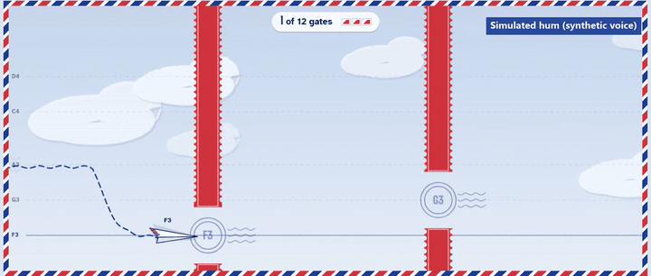
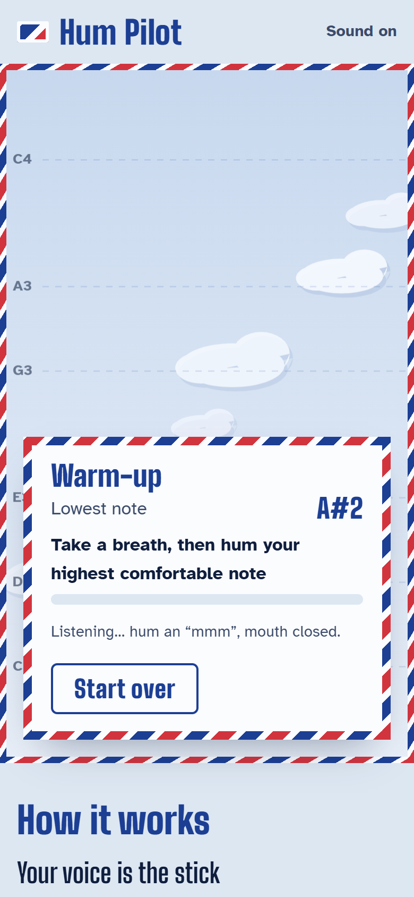
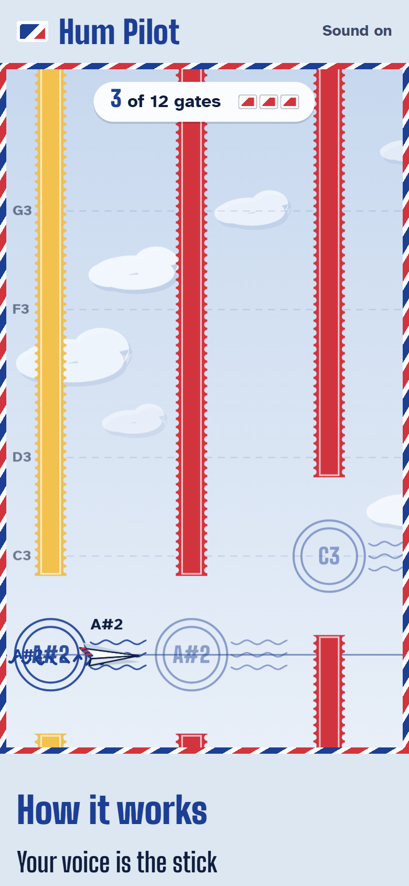
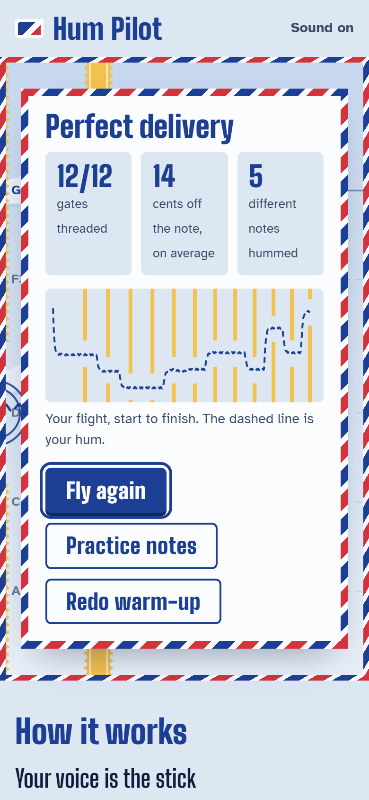

# Hum Pilot

**Fly a paper plane with your voice.** Hum a higher note to climb, a lower note to dive,
go quiet to glide. A ten-second warm-up tunes the sky to your own range, and every gap
sits on a real note in it, so threading the gaps means humming a little tune.

**Play it:** https://hum-pilot.pages.dev (works on a laptop or a phone; needs a microphone,
or fly with the arrow keys)

**Demo video (2:23):** https://youtu.be/NieI9CSODtk



*The hum here is a synthetic voice played into the browser as the microphone.*

| Phone: warm-up | Phone: in flight | Result |
| --- | --- | --- |
|  |  |  |

## Why

Most games need hands. In Hum Pilot, flying needs only a hum (the menus still take a
click or a key press), which could suit people who find a keyboard, mouse or touch
screen hard to use, or anyone with their hands busy. It has not been tested with users yet. Voice games usually assume one fixed range, which shuts out deep or high voices;
here the warm-up maps *your* lowest and highest comfortable notes onto the sky.

Because every gap is a real note of your range, each flight is also pitch practice, and
**Practice notes** mode makes that explicit: hold the plane in a ring on a target note for
one second, with live feedback in cents (100 cents is one semitone).

## How to play

1. Press **Start flying** and allow the microphone.
2. Warm-up: hum your lowest comfortable note and hold it, take a breath, then hum your
   highest. Mouth closed, an "mmm" works best.
3. Go quiet for a moment, then hum any note to take off.
4. Higher hum = climb, lower hum = dive, silence = glide. Thread 20 gates (the tests and video use a 12-gate level); three misses
   end the flight.

Headphones (or quiet speakers) help: the game's own sound effects are pitchless noise
bursts on purpose, so they can't steer the plane even if the microphone hears them.

## How it works

```
microphone ─▶ 2048-sample buffer, 60×/s ─▶ YIN pitch detector ─▶ tracker ─▶ plane height
                (browser voice processing off)                     │
                                                                   ├─ voicing gate (adapts to room noise)
                                                                   ├─ jump guard + "clearer reading wins"
                                                                   ├─ fresh start after a breath
                                                                   └─ median of 3 frames
warm-up (lowest + highest note) ─▶ your range ─▶ gates on its pentatonic notes, moving like a tune
```

- **Pitch detection**: YIN (de Cheveigné and Kawahara, 2002) in plain TypeScript, under
  1 ms per frame in Node and about 1-2 ms in the browser. Browser noise suppression and auto gain are switched off, because
  noise suppression treats a steady hum as noise.
- **Tracker**: turns noisy per-frame guesses into a steady control signal
  ([src/pitch/tracker.ts](src/pitch/tracker.ts)). Every stage exists because a test showed
  it was needed (below).
- **Calibration**: needs 1.5 s of each note, ignores the tail of the low note, and asks
  again if the two notes are fewer than 5 semitones apart
  ([src/game/calibrate.ts](src/game/calibrate.ts)).
- **Levels**: gaps sit on the major pentatonic notes of your range, so any sequence of
  them sounds musical; each gap is at least 3.2 semitones tall
  ([src/game/level.ts](src/game/level.ts)).
- Everything runs in the browser. No sound is recorded, uploaded or stored.

## What testing changed

Every version of the pitch tracker was scored on the same synthetic hums: four voices
from deep to high, every note in their range, clean and with room noise, with the true
pitch of every sample known. A frame is a *wrong note* when the pitch steering the plane
is more than half a semitone off the note being hummed.

| Version | Change | Wrong notes (quiet) | Wrong notes (room noise, SNR 10 dB) | Delay to a new note |
| --- | --- | --- | --- | --- |
| 0 | Autocorrelation peak | 23.9% | 30.3% | 76 ms |
| 1 | YIN | 0.3% | 0.6% | 59 ms |
| 2 | + median of 5 | 0.8% | 0.6% | 93 ms |
| 3 | + jump guard, hangover | 1.5% | 0.6% | 93 ms |
| 4 | + clearer reading wins | 1.5% | 0.6% | 93 ms |
| 5 | + fresh start after a breath | 1.3% | 0.6% | 93 ms |
| **6** | **median of 3 (shipped)** | **0.5%** | **0.6%** | **76 ms** |

What each test found, in order:
1. Autocorrelation jumped an octave on about 1 clean frame in 5: a hum's 2nd or 3rd harmonic is
   often louder than its fundamental. → YIN, no octave errors on clean hums.
2. My own metric punished smoothing for removing vibrato, and my test voice slid into
   notes after silences. → score steering against the intended note; fix the synth.
3. The jump guard could lock onto the wrong octave for ~100 ms after a breathy onset.
   → a clearly more periodic reading replaces the window at once.
4. The previous note dragged the start of the next. → a breath starts a fresh note,
   and a shorter median cut the delay back to 76 ms.
5. The noise gate took over 2 s to learn a room, and the first fix broke hearing.
   → the floor only rises on frames that are clearly not a voice.
6. Real-browser screenshots caught a visible score bar on the title screen, a trail
   that drew solid instead of dashed, and a practice ring smaller than the plane.

Full details: **[docs/TEST-LOG.md](docs/TEST-LOG.md)** (dated, with the numbers before and
after each change) and **[docs/ACCURACY.md](docs/ACCURACY.md)** (all tables).

**In a real browser.** Microsoft Edge with a fake microphone playing a synthetic hum, on
the live site, on a 12-gate test level: the game found the exact range hummed and threaded
12 of 12 gates (also 12 of 12 for a high voice in room noise). When the hum was deliberately
wrong on the 5th and 9th gates, exactly those two were missed. In practice mode, 8 of 8 notes were matched.

**Limits.** All voices in these tests are synthetic; the detector has not been scored on
labelled recordings of real people. In a very loud room (noise only 5 dB below the hum)
the game hears few frames and the plane mostly glides.

## Run it

```bash
npm install
npm run dev          # http://localhost:5193
npm test             # 29 unit tests: detector, tracker, warm-up, levels, flight
npm run accuracy     # re-scores every tracker version (about 1 minute), writes docs/accuracy.json
npm run fixtures     # writes the synthetic hum recordings used by the browser test
node --experimental-strip-types scripts/report.ts                 # docs/ACCURACY.md
node --experimental-strip-types scripts/e2e-mic.ts http://localhost:5193   # Edge + fake microphone
```

The browser test and screenshot scripts use Playwright with Microsoft Edge.

## Credits

- Pitch detection: the YIN algorithm, A. de Cheveigné and H. Kawahara, "YIN, a fundamental
  frequency estimator for speech and music", J. Acoust. Soc. Am. 111(4), 2002. Implemented
  from the paper; no pitch library is used.
- Pink noise for the room-noise tests: Paul Kellet's filter.
- Fonts: Big Shoulders Display and Atkinson Hyperlegible (SIL Open Font License), via Fontsource.
- Built with TypeScript and Vite; tested with Vitest and Playwright.
- The demo video's narration was made with the Kokoro text-to-speech model, offline.
- All art (the airmail sky, stamp gates, postmarks and paper plane) is drawn in code for
  this project. All sounds are synthesised in the browser.

## Licence

MIT. See [LICENSE](LICENSE).
